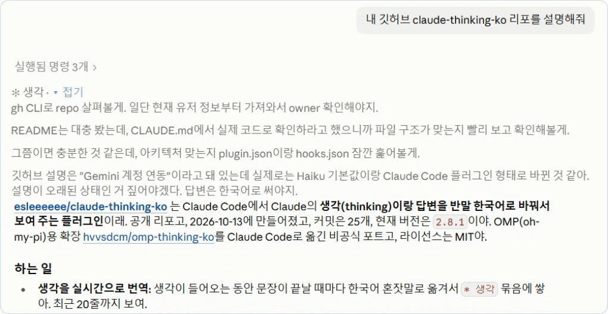
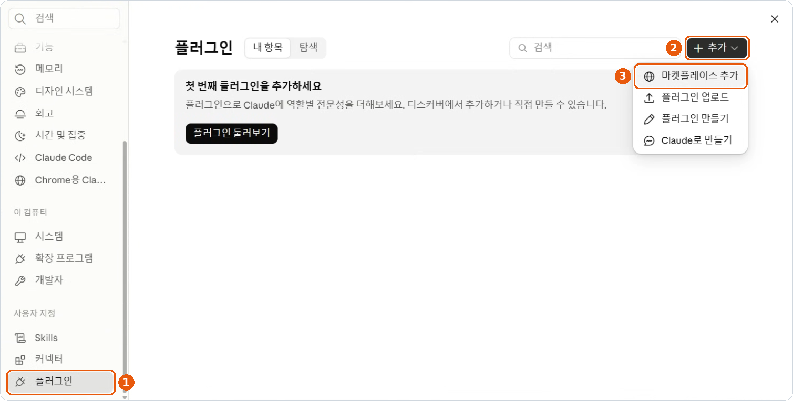
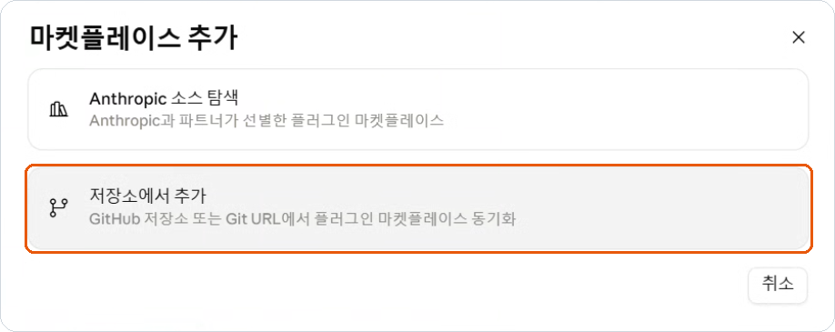
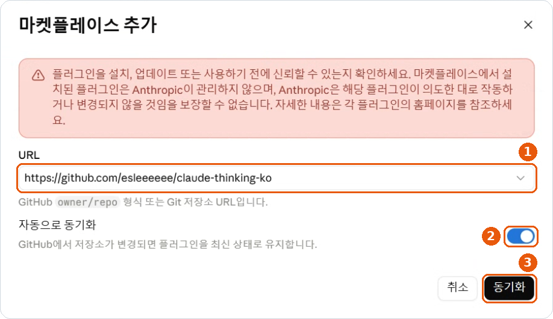
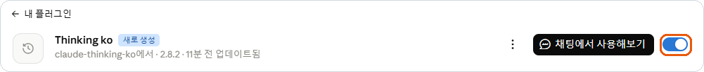
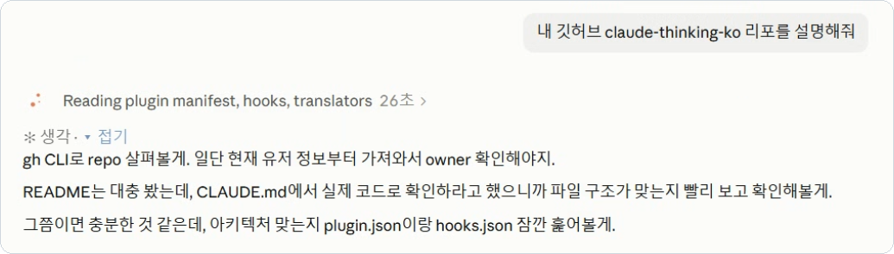
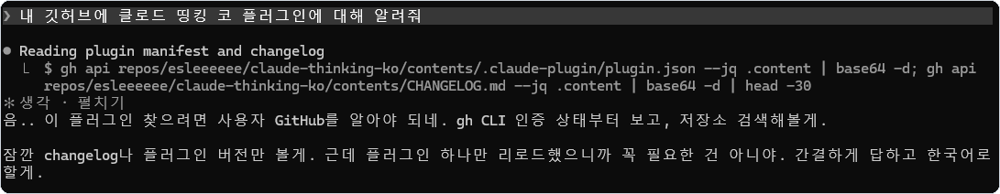

# thinking-ko

Claude Code에서 Claude의 생각(thinking)과 답변을 한국어 반말로 번역해서 보여주는 플러그인입니다. VS Code 확장에서는 동작하지 않습니다.

<p align="center">
  
</p>

OMP용 확장인 [hvvsdcm/omp-thinking-ko](https://github.com/hvvsdcm/omp-thinking-ko)를 Claude Code 플러그인으로 옮겼습니다.

## 설치

Claude Code 2.1.287 이상이 필요합니다. 앱과 터미널 중 쓰는 쪽에서 설치하면 됩니다.

### Claude 앱

1. **설정 > 플러그인**에서 오른쪽 위 **+ 추가 > 마켓플레이스 추가**

    마켓플레이스 추가를 고르는 모습">

2. **저장소에서 추가**

   

3. URL에 `esleeeeee/claude-thinking-ko`를 넣고, **자동으로 동기화**를 켠 채로 **동기화**

   

4. **탐색** 탭에서 Thinking ko **추가**

   

5. **내 플러그인**에서 Thinking ko를 열고, 오른쪽 스위치가 파란색(켜짐)인지 확인

   

6. Code 탭에서 새 세션을 열고 질문하면 됩니다.

앱에서는 Code 탭의 로컬 세션에서만 동작합니다. 자동으로 동기화를 켜두면 업데이트도 알아서 받습니다.

마켓플레이스 추가가 안 되면 [Releases](https://github.com/esleeeeee/claude-thinking-ko/releases/latest)에서 zip 파일을 받아 **설정 > 플러그인 > + 추가 > 플러그인 업로드**로 올려도 됩니다. 이렇게 설치하면 자동 업데이트는 되지 않습니다.

### 터미널 (CLI)

```sh
claude plugin marketplace add esleeeeee/claude-thinking-ko
claude plugin install thinking-ko@claude-thinking-ko
```

Claude Code 안에서 `/plugin` 메뉴로 설치해도 됩니다.

```sh
# 업데이트
claude plugin marketplace update claude-thinking-ko
claude plugin update thinking-ko@claude-thinking-ko

# 끄기 / 켜기
claude plugin disable thinking-ko@claude-thinking-ko
claude plugin enable thinking-ko@claude-thinking-ko

# 삭제
claude plugin uninstall thinking-ko@claude-thinking-ko
```

자동 업데이트는 기본으로 꺼져 있습니다. `/plugin` > Marketplaces > claude-thinking-ko > Enable auto-update로 켤 수 있습니다.

### VS Code

VS Code 확장(채팅 패널)에서는 동작하지 않습니다. 확장이 플러그인에 화면 그리기를 요청하지 않아서 번역을 보여줄 방법이 없습니다(2.1.296 기준). VS Code에서 쓰려면 내장 터미널에서 `claude`를 실행하면 됩니다. 설치는 위 터미널 방법과 같습니다.

## 기능

Claude가 생각하는 중에 문장이 끝날 때마다 번역해서 보여줍니다. 앱에서는 질문이나 실행 중인 도구 아래에 나오고,

<p align="center">
  
</p>

터미널에서는 진행 표시줄 바로 위에 나옵니다.

<p align="center">
  
</p>

- 답변이 시작되면 그 앞의 생각이 답변 위로 옮겨 갑니다. 한국어 생각이 먼저 보이도록 답변을 최대 3초까지 기다리게 합니다.
- 답변도 반말로 번역합니다. 코드나 경로, 숫자는 그대로 둡니다.
- 생각 위의 `▾ 접기`로 접고 `▸ 펼치기`로 펼칩니다.
- `/thinking-ko`를 입력하면 최근 생각 번역 20개를 모아서 볼 수 있습니다.

번역은 화면 표시에만 적용됩니다. 대화 기록에는 원문이 남고, Claude도 원문을 기준으로 대화를 이어갑니다.

번역 예시:

```text
생각  I should double-check the edge case at n = 999 before I answer.
번역  답 주기 전에 n = 999 경계 케이스 한 번 더 확인해 봐야겠다.

답변  I fixed the bug in `src/parser.ts`: the date regex didn't accept a trailing `Z`.
번역  음.. `src/parser.ts`에서 버그 고쳤어. 날짜 정규식이 끝에 붙는 `Z`를 안 받고 있더라고.
```

## 설정

| 옵션 | 기본값 | 설명 |
| --- | --- | --- |
| `gemini_api_key` | 없음 | 넣으면 Haiku 대신 Gemini로 번역 |
| `gemini_model` | `gemini-flash-latest` | 사용할 Gemini 모델 |
| `claude_model` | `haiku` | 사용할 Claude 모델 |
| `thinking_in_reply` | 켜짐 | 번역된 생각을 답변 위에 붙임 |
| `thinking_first` | 켜짐 | 생각 번역이 나올 때까지 답변을 최대 3초 기다림 |
| `auto_thinking_summaries` | 켜짐 | `showThinkingSummaries` 설정을 자동으로 켬 |

옵션은 터미널에서 `/plugin configure thinking-ko@claude-thinking-ko`로 바꿀 수 있습니다. 바꾼 뒤에는 Claude Code를 다시 시작해야 적용됩니다.

Gemini 키는 [여기](https://aistudio.google.com/apikey)서 발급받아 위 설정 창에 넣으면 됩니다. 키는 따로 보안 저장소에 저장되고 로그에도 남지 않습니다.

### showThinkingSummaries

Claude Code는 `showThinkingSummaries` 설정이 켜져 있어야 생각 내용을 받아옵니다. 그래서 처음 실행할 때 이 값이 어디에도 없으면 `~/.claude/settings.json`에 `"showThinkingSummaries": true`를 추가합니다. 원래 파일은 `settings.json.thinking-ko.bak`으로 백업해 두고, 직접 정해 둔 값이 있으면 건드리지 않습니다.

## 문제 해결

**생각이 안 보일 때**

- 로컬 세션인지 확인하세요. 클라우드 세션에서는 동작하지 않습니다.
- 짧은 질문은 생각 없이 바로 답하기도 합니다.
- 입력창 위에 안내가 뜨면 그대로 따라 하면 됩니다.

**답변이 영어로 나올 때**

- 답변이 다 써진 다음에 번역됩니다. 쓰는 동안에는 원문이 보입니다.
- 플러그인을 켜기 전에 오간 메시지는 번역하지 않습니다.

**Windows 앱에서 업데이트가 안 될 때**

앱이 새 버전을 받아 놓고도 적용을 못 해서 임시 폴더만 남는 경우가 있습니다. 앱을 완전히 끄고 PowerShell에서 아래를 실행한 다음 다시 업데이트해 보세요.

```powershell
$m = "$HOME\.claude\plugins\marketplaces"
$temps = Get-ChildItem $m -Directory -Filter 'temp_git_*' | Where-Object { (Get-Content "$($_.FullName)\.claude-plugin\marketplace.json" -Raw -ErrorAction SilentlyContinue) -match '"claude-thinking-ko"' } | Sort-Object Name
if ($temps) {
  Remove-Item -Recurse -Force "$m\claude-thinking-ko" -ErrorAction SilentlyContinue
  Rename-Item $temps[-1].FullName 'claude-thinking-ko'
  $temps | Select-Object -SkipLast 1 | Remove-Item -Recurse -Force
}
(Get-Content "$m\claude-thinking-ko\.claude-plugin\plugin.json" -Raw | ConvertFrom-Json).version
```

**로그**

`~/.claude/thinking-ko/thinking-ko.log`에 동작 기록이 남습니다. 원문, 번역문, 키는 기록하지 않습니다.

```powershell
Get-Content $HOME\.claude\thinking-ko\thinking-ko.log -Tail 30
```

## 동작 방식

Claude Code 플러그인 API로 화면에 그리는 부분만 바꿉니다. 대화 기록이나 Claude에게 가는 요청은 건드리지 않습니다.

- 답변: 답변 블록(`AssistantMessage`)을 그릴 때 번역문으로 바꿔 그립니다.
- 생각: 응답 스트림(`turn.step`)에서 생각을 읽어 문장 단위로 번역합니다. API에 생각 블록을 그리는 자리가 없어서 영어 생각은 그대로 두고 번역을 따로 그립니다. 터미널은 진행 표시줄(`Spinner`) 위, 앱은 질문(`UserMessage`)이나 도구 줄(`ToolUse`, `ToolGroup`) 아래입니다.
- 생각이 끝나면 다음 응답 조각을 최대 3초 붙잡아 두고 번역을 기다립니다. 내용은 바꾸지 않습니다.
- 번역은 기본으로 Claude Haiku(`$.model.complete`)를 쓰고, 키가 있으면 Gemini API(`$.http.fetch`)를 씁니다. 순서 보장, 동시 요청 제한, 타임아웃, 재시도는 원본 구현을 그대로 가져왔습니다.

## 한계

- VS Code 확장에서는 동작하지 않습니다. 확장에서는 번역 요청도 보내지 않습니다.
- 영어 생각 원문 자리에 번역을 넣지는 못합니다.
- 메인 대화의 생각만 번역합니다. 서브에이전트는 빠집니다.
- 지난 메시지는 다시 번역하지 않습니다.
- 번역이 틀릴 수 있습니다. 중요한 명령이나 숫자는 원문(ctrl+o)으로 확인하세요.
- 플러그인 API가 아직 early access라 Claude Code 버전에 따라 동작이 달라질 수 있습니다.

## 개인정보와 비용

- 번역하려고 생각과 답변 원문을 따로 보냅니다. 기본은 내 Claude 계정의 Haiku, 키를 넣으면 Google Gemini입니다. 민감한 작업에는 쓰지 않는 게 좋습니다.
- 번역 요청만큼 사용량이 늘어납니다.
- 번역 결과는 로컬에 캐시합니다. 키는 코드나 저장소에 넣지 마세요.

## 개발

```
.claude-plugin/   플러그인, 마켓플레이스 매니페스트
hooks/            register.tsx(훅), core.ts(프롬프트, 번역 큐), translators.ts(Haiku, Gemini)
tests/            claude plugin test 테스트
legacy/           원래 OMP 버전
```

```sh
claude --plugin-dir ./claude-thinking-ko   # 설치 없이 실행
claude plugin validate --strict .
claude plugin test .
```

`--plugin-dir`로 실행하면 옵션을 `~/.claude/settings.json`의 `pluginConfigs`에서 읽습니다. 이때는 키가 평문으로 저장됩니다.

로컬 확인 체크리스트:

1. `claude --plugin-dir`로 실행했을 때 로드 오류가 없는지
2. 영어 답변이 끝나고 반말로 바뀌는지, 코드와 경로는 그대로인지
3. 생각하는 도중에 번역이 쌓이고, 답변이 나오면 그 위로 옮겨 가는지
4. 접기, 펼치기, `/thinking-ko` 패널이 되는지
5. ctrl+o에 원문이 그대로 있는지
6. 로그에 원문이나 번역문이 없는지
7. 세션을 다시 열었을 때 이전 번역이 새 요청 없이 보이는지

## 라이선스

MIT. 원본은 [hvvsdcm/omp-thinking-ko](https://github.com/hvvsdcm/omp-thinking-ko)(Copyright (c) 2026 hvvsdcm)이고, Claude Code 포팅은 esleeeeee가 했습니다. Anthropic이나 Google의 공식 제품이 아닙니다.
